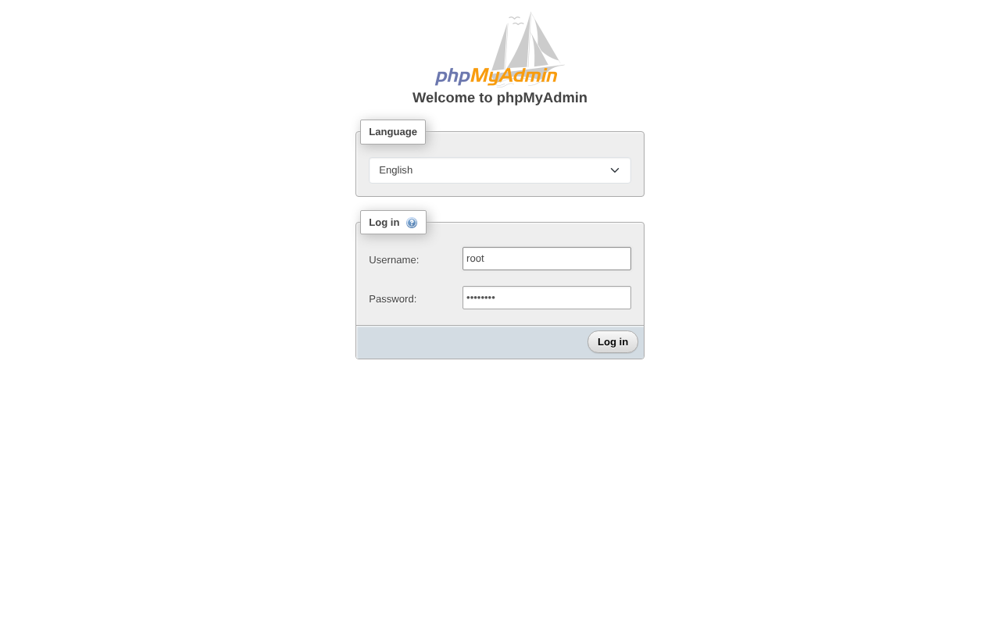
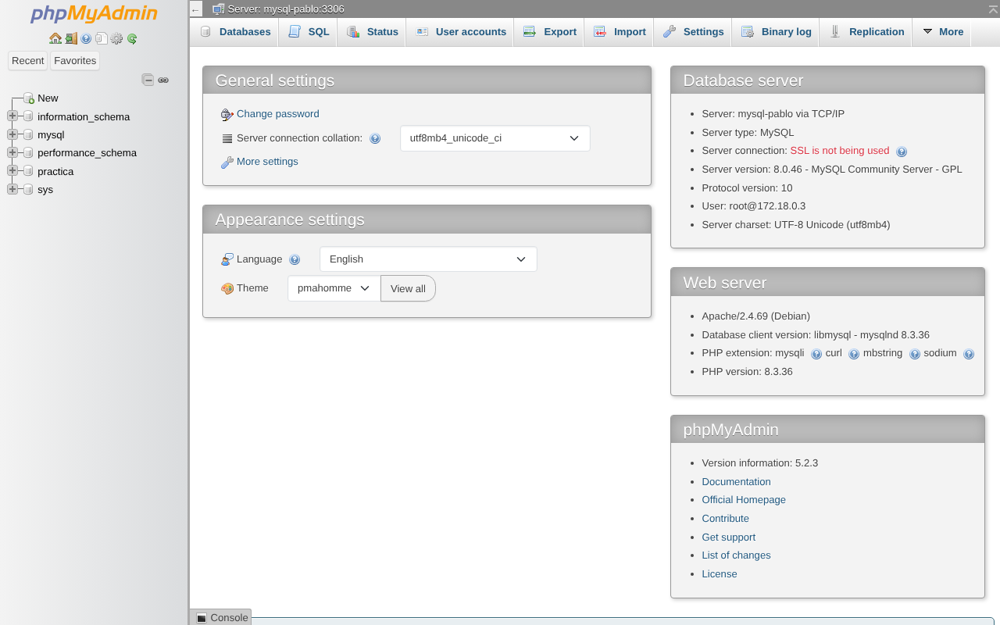
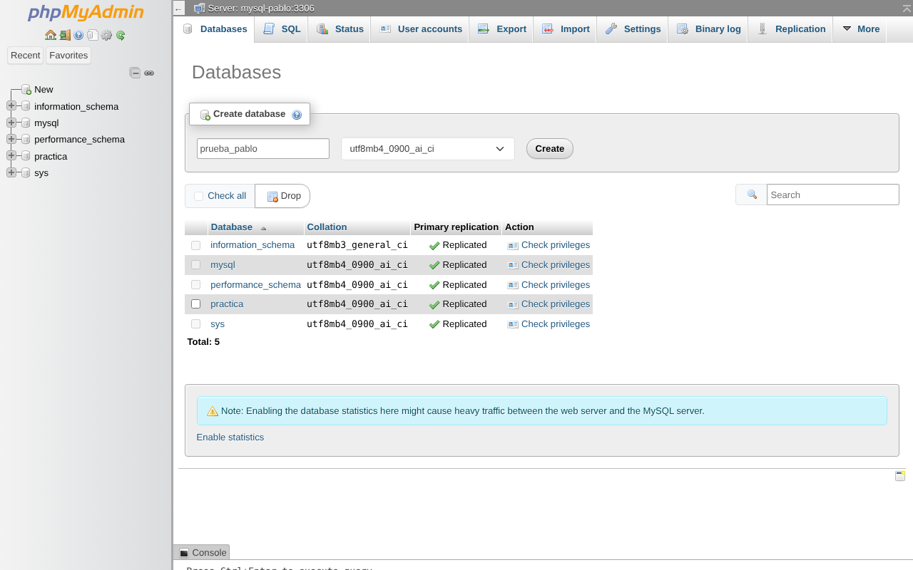
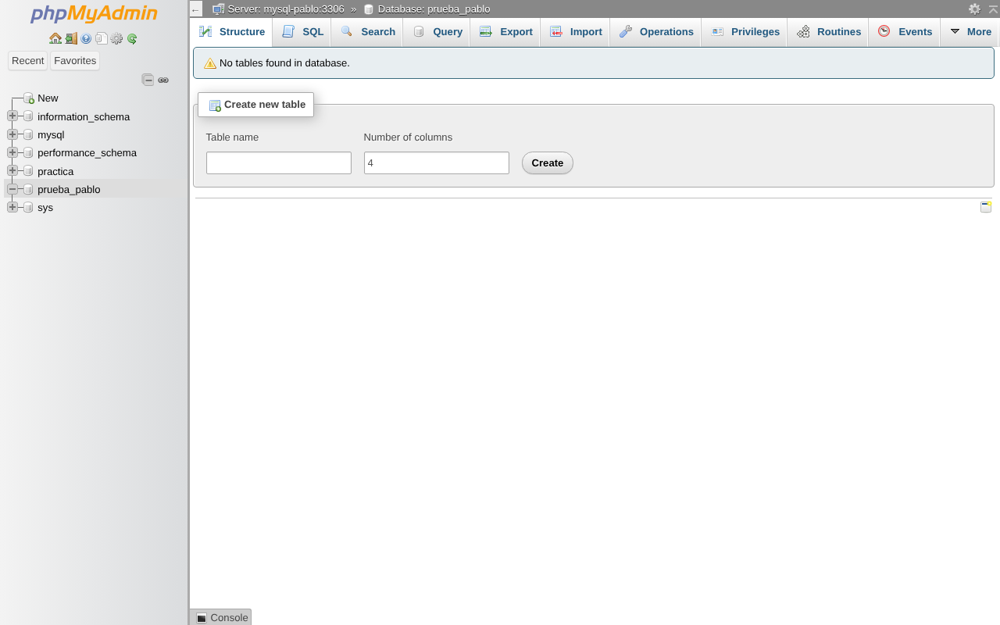
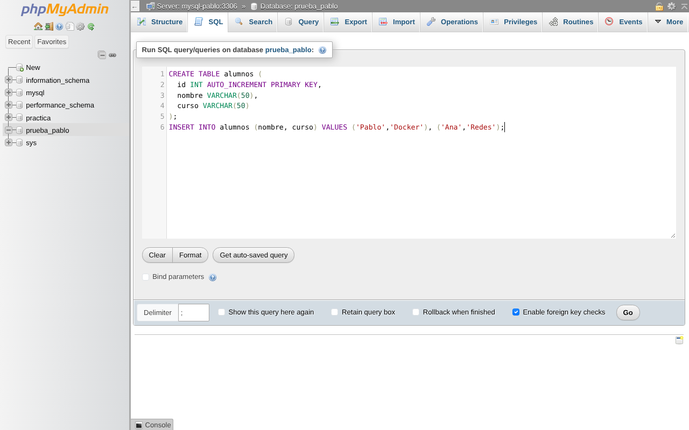
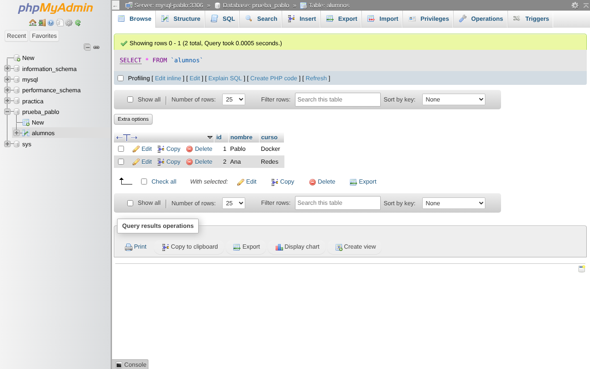

# Semana 3 – Red de contenedores: MySQL + phpMyAdmin

**Alumno:** Pablo Mora
**Tema:** Redes personalizadas en Docker y comunicación entre contenedores

---

## 1. Objetivo

Crear dos contenedores, uno con **MySQL** y otro con **phpMyAdmin**, y una **red personalizada de Docker** que les permita comunicarse. Después, entrar en phpMyAdmin, conectarse a MySQL y crear una base de datos de prueba desde la interfaz web.

## 2. Arquitectura

```
            Navegador (http://localhost:8080)
                         │
                         ▼  puerto 8080 → 80
 ┌───────────────── red-pablo (bridge 172.18.0.0/16) ─────────────────┐
 │                                                                    │
 │   ┌──────────────────────┐         ┌──────────────────────┐        │
 │   │  phpmyadmin-pablo    │  TCP    │     mysql-pablo      │        │
 │   │  172.18.0.3          │ ──────► │     172.18.0.2       │        │
 │   │  PMA_HOST=mysql-pablo│  3306   │     MySQL 8.0        │        │
 │   └──────────────────────┘         └──────────────────────┘        │
 │                                                                    │
 └────────────────────────────────────────────────────────────────────┘
```

phpMyAdmin no usa la IP de MySQL sino su **nombre de contenedor** (`mysql-pablo`). Esto funciona porque en una red personalizada Docker incluye un **DNS interno** que traduce el nombre del contenedor a su IP.

| Elemento | Nombre | Imagen | Puerto |
|---|---|---|---|
| Red | `red-pablo` | driver `bridge` | – |
| Base de datos | `mysql-pablo` | `mysql:8.0` | 3306 |
| Cliente web | `phpmyadmin-pablo` | `phpmyadmin:latest` | 8080 → 80 |

## 3. Paso a paso

### 3.1 Descargar las imágenes

```bash
docker pull mysql:8.0
docker pull phpmyadmin:latest
```

### 3.2 Crear la red personalizada

```bash
docker network create red-pablo
```

Comprobación:

```text
$ docker network ls --filter name=red-pablo
NETWORK ID     NAME        DRIVER    SCOPE
6873326645ad   red-pablo   bridge    local
```

### 3.3 Crear el contenedor de MySQL con sus credenciales

```bash
docker run -d \
  --name mysql-pablo \
  --network red-pablo \
  -e MYSQL_ROOT_PASSWORD=root1234 \
  -e MYSQL_USER=pablo \
  -e MYSQL_PASSWORD=pablo1234 \
  -e MYSQL_DATABASE=practica \
  -p 3306:3306 \
  mysql:8.0
```

| Variable | Para qué sirve |
|---|---|
| `MYSQL_ROOT_PASSWORD` | Contraseña del usuario administrador `root` (obligatoria) |
| `MYSQL_USER` / `MYSQL_PASSWORD` | Crea un usuario normal `pablo` |
| `MYSQL_DATABASE` | Crea la base de datos `practica` al arrancar y da permisos sobre ella a `pablo` |

### 3.4 Crear el contenedor de phpMyAdmin

```bash
docker run -d \
  --name phpmyadmin-pablo \
  --network red-pablo \
  -e PMA_HOST=mysql-pablo \
  -e PMA_PORT=3306 \
  -p 8080:80 \
  phpmyadmin:latest
```

- `PMA_HOST=mysql-pablo` → phpMyAdmin busca el servidor MySQL por su **nombre** dentro de la red.
- `-p 8080:80` → la web se abre desde el ordenador en `http://localhost:8080`.
- El usuario y la contraseña se escriben en la pantalla de login (`root` / `root1234` o `pablo` / `pablo1234`).

### 3.5 Comprobar que los dos contenedores están conectados a la red

```text
$ docker ps
NAMES              IMAGE               STATUS         PORTS
phpmyadmin-pablo   phpmyadmin:latest   Up 4 seconds   0.0.0.0:8080->80/tcp
mysql-pablo        mysql:8.0           Up 4 seconds   0.0.0.0:3306->3306/tcp, 33060/tcp

$ docker network inspect red-pablo --format '{{range .Containers}}{{.Name}} -> {{.IPv4Address}}{{"\n"}}{{end}}'
phpmyadmin-pablo -> 172.18.0.3/16
mysql-pablo -> 172.18.0.2/16
```

Prueba de comunicación por nombre (desde dentro del contenedor de phpMyAdmin):

```text
$ docker exec phpmyadmin-pablo getent hosts mysql-pablo
172.18.0.2      mysql-pablo

$ docker exec phpmyadmin-pablo bash -c '(echo > /dev/tcp/mysql-pablo/3306) && echo "Puerto 3306 alcanzable"'
Puerto 3306 alcanzable
```

> Si un contenedor ya existía sin red, también se puede conectar después con:
> `docker network connect red-pablo <nombre-contenedor>`

### 3.6 Entrar en phpMyAdmin

Abrir `http://localhost:8080` e iniciar sesión con `root` / `root1234`.



Arriba se ve **Server: mysql-pablo:3306**, que confirma que phpMyAdmin está conectado al contenedor de MySQL a través de la red:



### 3.7 Crear la base de datos de prueba desde la interfaz

Pestaña **Databases** (Bases de datos) → escribir `prueba_pablo` → **Create**.



La base de datos aparece en el árbol de la izquierda:



### 3.8 Crear una tabla e insertar datos (pestaña SQL)

```sql
CREATE TABLE alumnos (
  id INT AUTO_INCREMENT PRIMARY KEY,
  nombre VARCHAR(50),
  curso VARCHAR(50)
);
INSERT INTO alumnos (nombre, curso) VALUES ('Pablo','Docker'), ('Ana','Redes');
```



Resultado en la tabla:



### 3.9 Verificación desde la terminal

Para confirmar que los datos se guardaron de verdad en el contenedor de MySQL:

```text
$ docker exec mysql-pablo mysql -uroot -proot1234 -e "SHOW DATABASES; SELECT * FROM prueba_pablo.alumnos;"
Database
information_schema
mysql
performance_schema
practica
prueba_pablo
sys
id	nombre	curso
1	Pablo	Docker
2	Ana	Redes
```

## 4. Alternativa con Docker Compose

El mismo montaje en un solo archivo: [`docker-compose.yml`](docker-compose.yml). Compose crea la red automáticamente y conecta ambos servicios.

```bash
docker compose up -d      # levantar
docker compose down       # parar y borrar contenedores y red
```

Todos los comandos manuales están también en [`comandos.sh`](comandos.sh).

## 5. Limpieza

```bash
docker rm -f phpmyadmin-pablo mysql-pablo
docker network rm red-pablo
```

## 6. Problemas típicos y cómo solucionarlos

| Problema | Causa | Solución |
|---|---|---|
| phpMyAdmin dice *"mysqli::real_connect(): (HY000/2002)"* | MySQL todavía estaba arrancando (tarda unos segundos la primera vez) | Esperar a ver `ready for connections` en `docker logs mysql-pablo` |
| phpMyAdmin no encuentra el servidor | Los contenedores estaban en la red `bridge` por defecto, que **no** tiene DNS por nombre | Usar una red personalizada (`--network red-pablo`) |
| Error de puerto ocupado al arrancar | Ya había otro MySQL o servicio usando el 3306 / 8080 del ordenador | Cambiar el puerto de la izquierda, por ejemplo `-p 3307:3306` |

## 7. Conclusiones / Lo aprendido

1. **Las redes personalizadas de Docker tienen DNS interno**: los contenedores se encuentran por su nombre, sin necesidad de conocer la IP (que además puede cambiar al reiniciar).
2. La red `bridge` por defecto **no** resuelve nombres; por eso conviene crear siempre una red propia para aplicaciones con varios contenedores.
3. Las **variables de entorno** (`-e`) permiten configurar credenciales y bases de datos sin modificar la imagen.
4. `-p host:contenedor` publica un puerto hacia fuera; la comunicación **entre** contenedores de la misma red no necesita publicar puertos.
5. phpMyAdmin facilita administrar MySQL de forma gráfica: crear bases de datos, tablas y ejecutar SQL.
6. En un proyecto real las contraseñas no deberían estar escritas en texto plano: se usarían un archivo `.env` o *Docker secrets*, y un **volumen** para que los datos no se pierdan al borrar el contenedor.

## 8. Audio explicativo

🎧 [Audio de 60 segundos con lo aprendido](audio/) *(pendiente de subir)*
